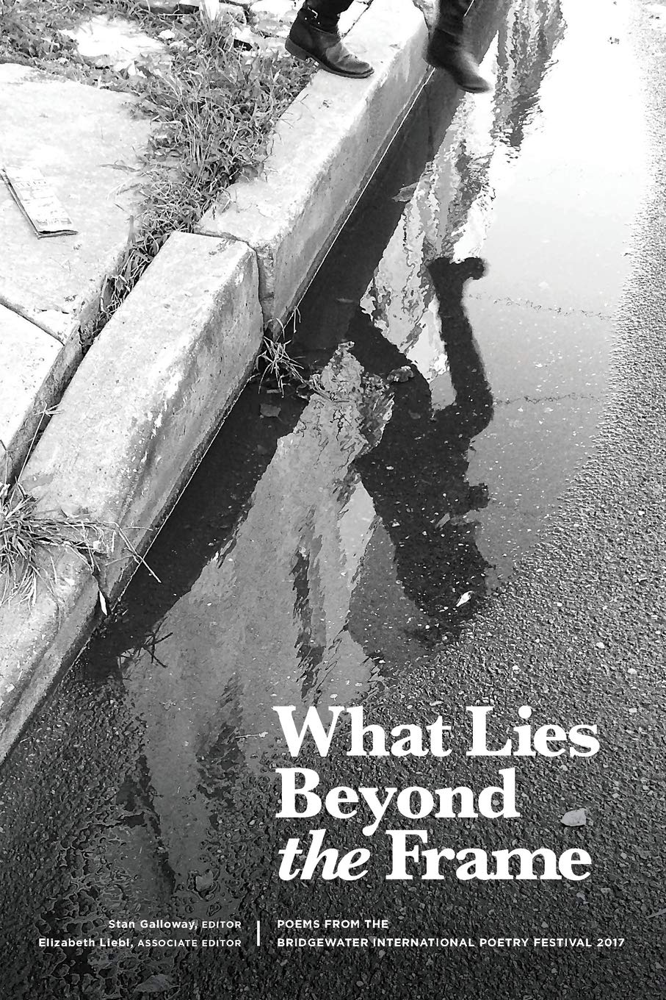

This anthology is the result of the Bridgewater International Poetry Festival. In 2017, the festival occurred in January and was held at Bridgewater College, a small school nestled in the Shenandoah Valley. In this anthology, we have used poems read at this year's festival to attempt to answer the questions unasked by the title: what, exactly, lies beyond the frame? I hope you find the answer here satisfactory enough to look further beyond your own frame, whether it be the frame of your laptop, your window, or your doorway.
