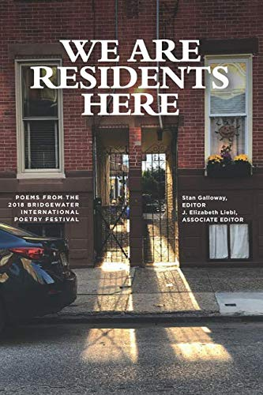

This anthology, like the ones before it, is a result of the Bridgewater International Poetry Festival, which is held annually at Bridgewater College in the middle of Virginia's Shenandoah Valley. The anthology begins with poems that describe who we, the collective whole, are and how we feel. As you read these poems, and indeed, all of the poems collected here, I challenge you to dive deeper than the surface of these poems and to explore the true depth of the lives presented.
